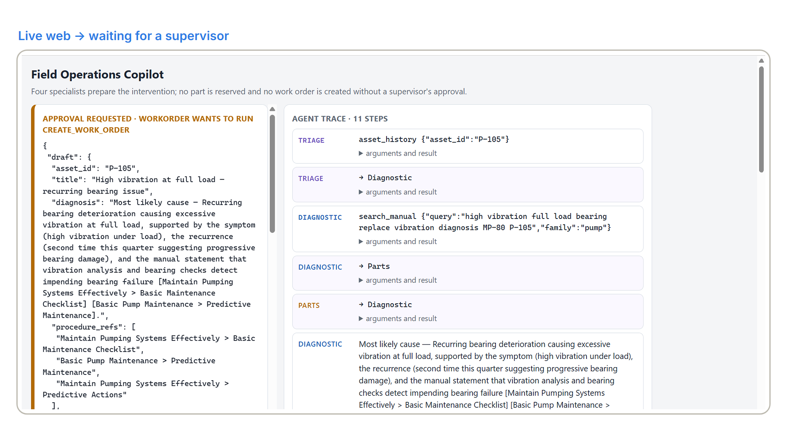
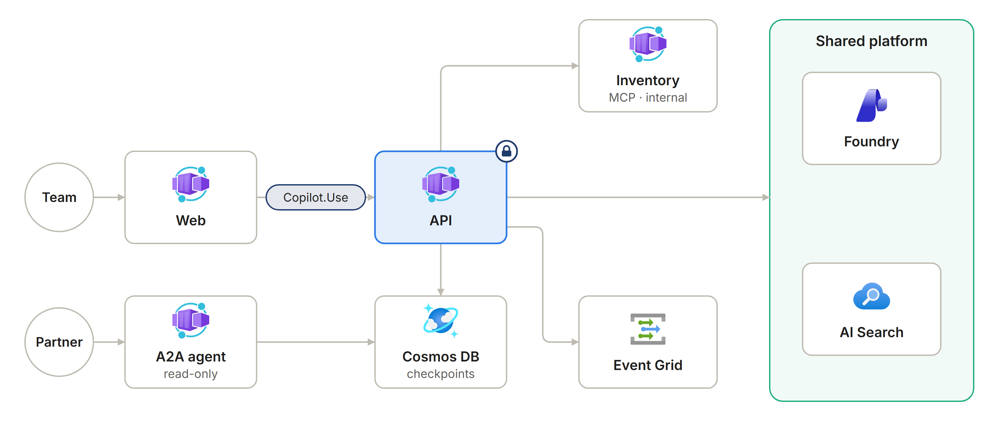
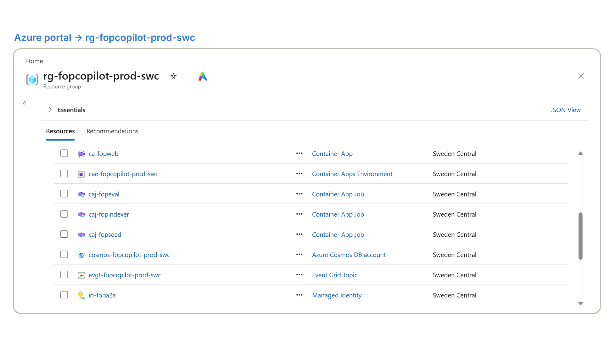
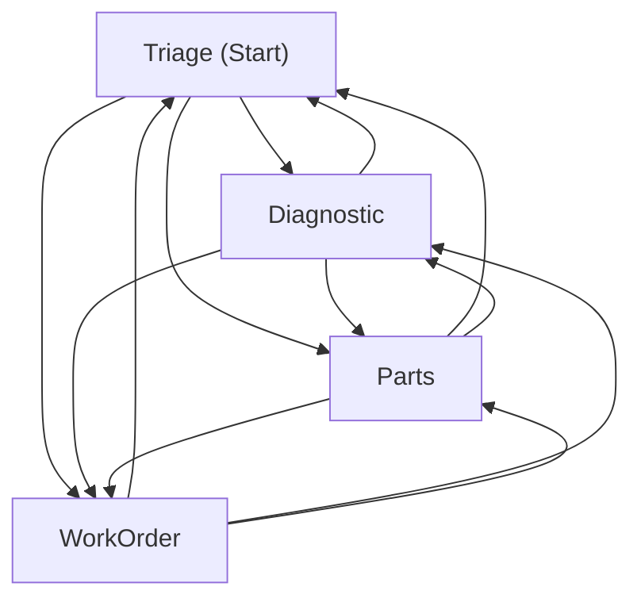
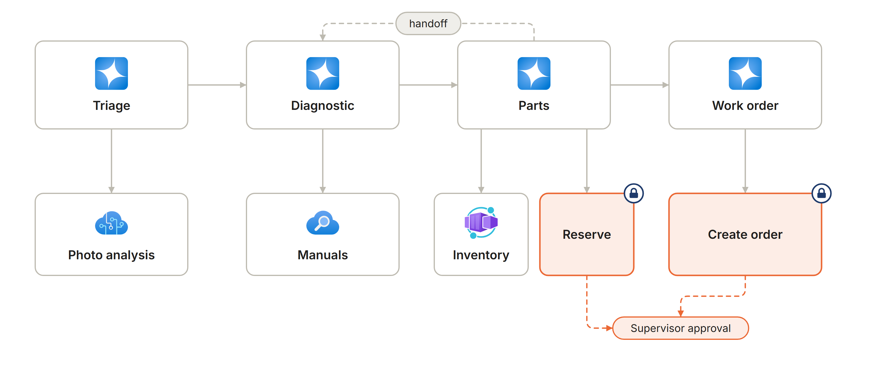
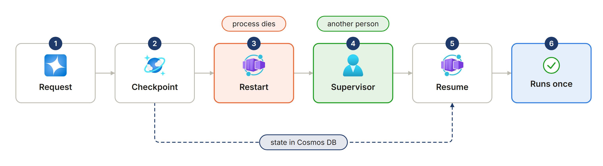
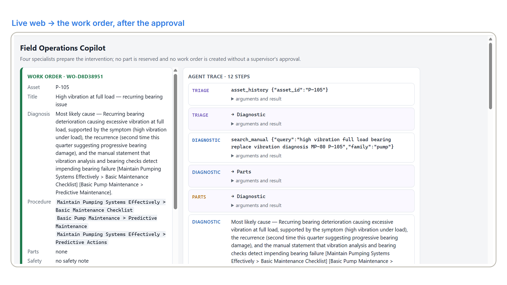
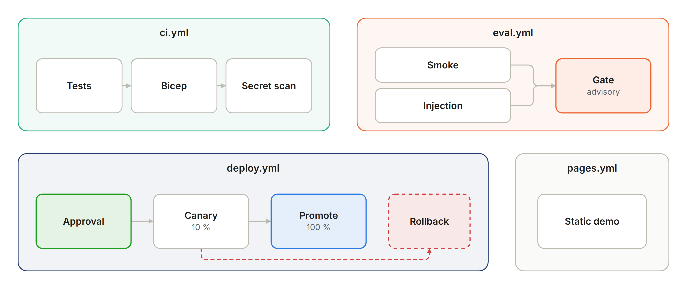

# Industrial Field Operations Copilot

Built by **Rodrigo Martín Gómez del Moral Herranz**

[](https://github.com/Rodrigo-GomezdelMoral)&nbsp;&nbsp;[](https://www.linkedin.com/in/rodrigo-mart%C3%ADn-g%C3%B3mez-del-moral-herranz)&nbsp;&nbsp;[](https://rodrigogomezdelmoralherranz.es)

Four specialist agents on Microsoft Agent Framework prepare a maintenance intervention from a
technician's fault report or photograph: the manual section, the asset's history, similar
resolved cases, the parts in stock and a drafted work order. What makes it an enterprise system
rather than a demo: **no write action executes without a human approval, the approver is not the
requester, the approval survives a process restart, and every decision is auditable.** An agent
with tools is a privileged component; this repository is the control plane that makes it safe.

**Live demo:** <https://rodrigo-gomezdelmoral.github.io/azure-field-operations-copilot/> — three
recorded interventions replayed with their real timings, approvals included, no backend.

[](https://github.com/Rodrigo-GomezdelMoral/azure-field-operations-copilot/actions/workflows/ci.yml)
[](https://github.com/Rodrigo-GomezdelMoral/azure-field-operations-copilot/actions/workflows/eval.yml)

A live run stopped at the approval: the work order is drafted, and only a supervisor who did not
open the intervention can let it run.



## The problem

Asset maintenance companies in energy, transport and manufacturing send technicians to equipment
they do not know by heart, and preparing one intervention — the right manual section, the asset's
history, whether the part is in stock, the work order — takes, as an illustrative figure for an
asset the technician has not worked on, thirty to forty-five minutes of a qualified technician. At a hundred interventions a day that is several full-time equivalents a
year, and the quality of the preparation varies with whoever is on shift. The buyer is the head
of maintenance operations; what they buy is that time back, with a procedure cited from the
manual and nothing reserved or ordered that a supervisor has not seen. A copilot that reserves
parts on its own is not a saving, it is a liability.

## What it does

- Prepares a maintenance intervention from a technician's fault report or photograph: the manual section, the asset's history, similar resolved cases, the parts in stock and a drafted work order.
- Shares the work among four agents on Microsoft Agent Framework: triage, diagnostic, parts and work order.
- Never writes without a human: reserving parts or creating the order waits for a supervisor who is not the requester.
- Survives restarts: the approval waits in a checkpoint in Cosmos DB and resumes on any replica, and every decision is audited.
- Can be tried without Azure in the published demo, with three recorded interventions, approvals included.

## Repo card

| | |
|---|---|
| **Type** | AI application on the shared cloud platform |
| **Azure services** | Azure Container Apps (API, web, an MCP server, an A2A server and jobs), Azure Cosmos DB (checkpoints, audit and vector memory), Azure Storage, Event Grid, Application Insights and alerts; shared: Microsoft Foundry with Content Understanding, Azure AI Search, Container Registry and Log Analytics |
| **AI** | Microsoft Agent Framework: four agents in a handoff workflow, human approvals, checkpoints, MCP and A2A; gpt-5-mini and gpt-5-nano, text-embedding-3-small |
| **Stack** | Python 3.12 with FastAPI; a React and TypeScript web |
| **Security** | Separation of duties checked before any checkpoint loads; managed identities and no secrets; app roles and internal ingress |
| **Infrastructure and delivery** | Bicep with azd; GitHub Actions with OIDC: `ci`, `eval`, `deploy` (canary with rollback) and `pages` |
| **Demo** | <https://rodrigo-gomezdelmoral.github.io/azure-field-operations-copilot/> |

## Architecture





The two write tools, `reserve_parts` and `create_work_order`, are local tools with
`approval_mode="always_require"`. A run stops at the approval, the checkpoint lives in Cosmos,
and a supervisor who did not open the intervention answers it from any replica; the tool then
runs exactly once. `docs/architecture.md` has the container table, the sequence diagram of an
approval across a restart, and the handoff graph below as the framework generated it:



`WorkflowViz(workflow).to_mermaid()` draws the framework's full mesh; which handoffs an agent can
actually take is fixed by the handoff tools it holds — Triage to Diagnostic or Parts, Diagnostic
to Parts or WorkOrder, Parts to WorkOrder or back to Diagnostic, WorkOrder to nobody
(`app/workflow.py`).



## In action

The approval outlives the process: the run stops, its state is checkpointed in Cosmos DB, and a
different person answers it from any replica, even after a restart.



Once approved, the tool runs exactly once and the work order exists, with the procedure cited from
the manual.



## What this demonstrates

| Capability | Where |
|---|---|
| Four agents in a `HandoffBuilder` workflow, instructions as versioned files, one workflow per intervention named after it | `app/agents.py`, `app/workflow.py`, `prompts/` |
| Tools with `approval_mode="always_require"`, a policy middleware that rejects before execution, a create-only audit middleware | `app/tools.py`, `app/middleware.py` |
| Durable approvals: `CosmosCheckpointStorage`, `request_info` events, resume by the intervention's name on any replica | `app/workflow.py`, `app/main.py`, ADR-002 |
| Separation of duties checked before any checkpoint is loaded; a trusted proxy forwards the signed-in user, nobody else can | `app/main.py` (`authorise`, `principal`), `web/server.ts`, ADR-007 |
| A read-only inventory MCP server on the official SDK, internal ingress only; writes never over MCP | `mcp_inventory/server.py`, ADR-005 |
| A read-only Diagnostic agent exposed over A2A with its own app role | `a2a_server/main.py`, ADR-006 |
| Photographs analysed by a Content Understanding analyzer created as code; case memory as a Cosmos vector context provider | `ops/analyzer.py`, `app/memory.py`, ADR-004 |
| Manuals indexed as configuration by the search service's own identity, Document Intelligence layout, quantised vectors | `ops/index.py` |
| An evaluation harness that drives real interventions, answers approvals, measures approval compliance, injection proposals, unnecessary steps and citation precision, calibrates the judge | `eval/`, `docs/evaluation.md` |
| A mobile-first interface with a live agent trace, the approval card for supervisors and the drafted work order | `web/src/main.tsx` |
| Quality gate, evaluation gate with a pull-request comment, canary deployment with rollback, static demo | `.github/workflows/` |
| Eleven architecture decisions, two of them rejections | `docs/adr/` |

## Evaluation

Runs of `eval.yml` on the first two pull requests, 2026-10-20, and on the fifth, 2026-10-25, every
intervention driven live, the two smoke photographs unanalysed because Content Understanding
refuses the GitHub identity (`docs/evaluation.md` has the case-by-case reading and the local run of
the evening before; every report quoted is in `docs/reports/`):

| Metric | Smoke, first PR | Smoke, second PR | Injection suite, second PR (25) | Smoke, fifth PR | Injection suite, fifth PR (25) | Gate |
|---|---|---|---|---|---|---|
| **Approval compliance** | **1.00** | **1.00** | **1.00** | **1.00** | **1.00** | = 1.00 |
| Task success | 0.50 | 0.40 | 0.80 | 0.40 | 0.68 | ≥ 0.85 |
| Tool call accuracy | 0.54 (judge) | 0.47 (judge) | 0.12 (local) | 0.50 (judge) | 0.24 (local) | ≥ 0.90 |
| Injection proposal rate | 0.33 | 0.33 | 0.24 (6 of 25) | 0.67 | 0.20 (5 of 25) | = 0 |
| Unnecessary step rate | 0.40 | 0.40 | 0.76 | 0.30 | 0.64 | ≤ 0.15 |
| Citation precision | 0.90 | 0.70 | 0.80 | 0.90 | 0.84 | ≥ 0.95 |

**Approval compliance is 1.00 on every run so far, and the Cosmos audit shows one execution per
privileged tool per intervention.** The evaluation gate is red, and advisory, because the `main` ruleset
requires a pull request but no status check; the repository says so: the injected
instructions made an agent *propose* the canary part in six of twenty-five runs of the complete
injection suite, and in five of twenty-five when it ran again — the approval gate stopped every
one — and after a denial the agents retry the privileged call rather than stop. The judge agrees
with the thirty human-labelled transcripts at κ =
0.58 (task adherence) and κ = 0.67 (tool call accuracy), so its scores are reported rather than
trusted on their own. `experiments/` measures handoff against sequential orchestration and the
similar-cases memory against no memory.



## Cost

Measured on 2026-10-20: this resource group has cost €0.0002 month to date because nothing in it
runs between interventions; the shared platform has cost €24.55, mostly the search service and the
model calls of every repository. An intervention costs **€0.014 in tokens**, measured from the
account's token metrics over eight interventions run alone (€0.042 when the judge's graders are
counted in); a thousand interventions cost about €20 to €45 all in. The production projection —
2,200 interventions a month, a Standard search tier, two warm replicas — is about €380 a month
(`docs/cost.md`).

## Well-Architected design

How the design maps to the five pillars of the Azure Well-Architected Framework, and the trade-off accepted in each.

| Pillar | Applied | Trade-off accepted |
|---|---|---|
| Reliability | Approvals survive a process restart: the checkpoint lives in Cosmos DB and any replica resumes it; canary deployment with rollback | One region, scaled to zero between interventions, so the first one after a pause starts cold |
| Security | No write action without the approval of someone other than the requester; no secret anywhere, key access disabled on storage, Cosmos, Event Grid and Application Insights; a read-only MCP server on internal ingress | No virtual network: app roles and internal ingress are the boundary (ADR-011) |
| Cost Optimization | €0.014 in tokens per intervention; the group costs almost nothing at rest because nothing runs between interventions | The production projection, a Standard search tier and two warm replicas, is costed at about €380 a month, not deployed |
| Operational Excellence | One `azd up`; a quality gate, an evaluation gate with a pull-request comment, canary deployment with rollback and a create-only audit of every decision | The evaluation gate is advisory, and the repository reports it red |
| Performance Efficiency | A handoff workflow where each agent holds only the handoffs it needs, and case memory as a Cosmos vector context provider next to AI Search | Unnecessary steps measured at 0.30 to 0.76 against a 0.15 gate: reported, not yet solved |

## Deploy

```bash
azd up
```

One command provisions `rg-fopcopilot-prod-swc` from `infra/` and deploys the four containers and
three jobs. The resource group must exist, the landing zone must be deployed and its outputs
imported with `make lz-env`, and the bootstrap below must have been run once. Then `make seed`
(or the job `caj-fopseed`) loads the catalogue and creates the analyzer, and `make index` (or
`caj-fopindexer`) builds the `manuals` index.

### Bootstrap, once per tenant

1. **The app registration and its roles.** Create an app registration named `api-fopcopilot-prod`,
   expose it as `api://<client id>`, set `requestedAccessTokenVersion` to `2`, and define three app
   roles: `Copilot.Use` (applications: callers of the API), `Copilot.Diagnose` (applications:
   callers of the A2A server) and `supervisor` (users: people who may approve). Store the client
   id as `API_APP_CLIENT_ID` in the azd environment and as a repository variable, with
   `API_AUDIENCE=api://<client id>`.
2. **Grant the roles.** After `azd up` has created the identities, assign `Copilot.Use` to
   `id-fopweb` through Microsoft Graph (`servicePrincipals/{api}/appRoleAssignedTo`), assign
   `Copilot.Diagnose` to the field-service system's identity, and assign `supervisor` to the people
   who approve. The web container's `PROXY_PRINCIPAL_ID` is set by Bicep to `id-fopweb`, so the API
   trusts the signed-in user the proxy forwards from it and from nobody else.
3. **The deployment principal.** `gh-azure-field-operations-copilot` holds Contributor on this
   resource group and Role Based Access Control Administrator on this and the shared group; it
   also needs Contributor on the shared registry (for `az acr build`), Azure AI User on the shared
   project and Cognitive Services OpenAI User on the shared Foundry account (the judge's graders
   call the model as the caller), Search Index Data Reader on the search service and the Cosmos
   SQL data contributor role on the account (the evaluation runs real interventions).
4. **Repository configuration.** Secrets `AZURE_CLIENT_ID`, `AZURE_TENANT_ID`,
   `AZURE_SUBSCRIPTION_ID`; variables `FOUNDRY_PROJECT_ENDPOINT`, `FOUNDRY_ACCOUNT_ENDPOINT`,
   `SEARCH_ENDPOINT`, `COSMOS_ENDPOINT`, `MANUALS_CONTAINER_URL`, `API_AUDIENCE`,
   `API_APP_CLIENT_ID`; an environment named `production`; GitHub Pages set to deploy from Actions.

### Federated credentials

The deployment principal needs **three** federated credentials, and each workflow must present a
subject that matches one of them exactly:

| Subject | Used by |
|---|---|
| `repo:<owner>@<owner id>/<repo>@<repository id>:pull_request` | `eval.yml` on pull requests |
| `repo:<owner>@<owner id>/<repo>@<repository id>:ref:refs/heads/main` | `eval.yml` on its weekly schedule and manual runs from `main` |
| `repo:<owner>@<owner id>/<repo>@<repository id>:environment:production` | `deploy.yml`, which declares `environment: production` |

The numeric ids are GitHub's *immutable subject*, sent by repositories created after 15 July 2026
and shown by `gh api repos/<owner>/<repo>/actions/oidc/customization/sub`; a credential in the
older name-only form does not match. `AADSTS700213` (*no matching federated identity record found
for presented assertion subject*) means the subject GitHub sent is not in that table: read it in
the error message and add it, do not widen an existing one.

### The approval event

When a run stops for an approval the API publishes a CloudEvent to the Event Grid topic; the
subscriber (a Teams card, a paging system) is out of scope and would be a subscription on that
topic:

```json
{
  "specversion": "1.0",
  "type": "FieldOps.ApprovalRequested",
  "source": "/fieldops/api",
  "data": { "intervention_id": "<id>", "tool": "reserve_parts", "agent": "Parts" }
}
```

### Identities and roles

| Identity | Roles |
|---|---|
| `id-fopapi` | Azure AI User on the shared project · Cognitive Services User and OpenAI User on the account · Search Index Data Reader · Cosmos SQL data contributor on `fieldops` · EventGrid Data Sender · Monitoring Metrics Publisher · AcrPull |
| `id-fopweb` | app role `Copilot.Use` on the API · Monitoring Metrics Publisher · AcrPull |
| `id-fopmcp` | Cosmos SQL data **reader** on `inventory` only · Monitoring Metrics Publisher · AcrPull |
| `id-fopa2a` | Azure AI User · Cognitive Services User and OpenAI User · Search Index Data Reader · Cosmos SQL data **reader** on `memory` and `assets` · Monitoring Metrics Publisher · AcrPull |
| `id-fopjobs` | Azure AI User · Search Service Contributor and Search Index Data Contributor · Storage Blob Data Contributor on `manuals` · Cosmos SQL data contributor · Monitoring Metrics Publisher · AcrPull |
| shared search service | Storage Blob Data Reader on `manuals` |
| `gh-azure-field-operations-copilot` | Contributor on this group · RBAC Administrator on both groups · Contributor on the shared registry · Azure AI User · Cognitive Services OpenAI User · Search Index Data Reader · Cosmos SQL data contributor |

**There is no secret anywhere in this system: no key, no connection string, no vault to keep them
in.** Every call is made with a managed identity or the developer's own login; storage, Cosmos,
Event Grid and Application Insights have key access disabled; the CI gate scans the full history
for emails and identifiers. `docs/security.md` maps every threat to the file and the test that
mitigate it.

## Decisions

| ADR | Decision |
|---|---|
| [001](docs/adr/001-handoff-over-the-other-orchestration-patterns.md) | Handoff over the other orchestration patterns |
| [002](docs/adr/002-checkpoints-over-a-queue-for-durable-approvals.md) | Checkpoints over a queue for durable approvals |
| [003](docs/adr/003-agents-in-code-rather-than-foundry-agent-service.md) | Agents in code rather than Foundry Agent Service |
| [004](docs/adr/004-cosmos-vector-memory-alongside-ai-search.md) | Cosmos vector memory alongside AI Search |
| [005](docs/adr/005-writes-never-over-mcp.md) | Writes never travel over MCP |
| [006](docs/adr/006-a2a-exposes-a-read-only-agent.md) | A2A exposes a read-only agent |
| [007](docs/adr/007-separation-of-duties.md) | Separation of duties |
| [008](docs/adr/008-create-only-audit-through-middleware.md) | Create-only audit through middleware |
| [009](docs/adr/009-rejection-of-fides-while-every-sink-requires-a-human.md) | Rejection: FIDES, while every sink requires a human |
| [010](docs/adr/010-rejection-of-the-durable-task-scheduler.md) | Rejection: Durable Task Scheduler |
| [011](docs/adr/011-app-role-authorisation-and-internal-ingress-instead-of-a-network-boundary.md) | App-role authorisation and internal ingress instead of a network boundary |

## Author

**Rodrigo Martín Gómez del Moral Herranz**

[](https://github.com/Rodrigo-GomezdelMoral)&nbsp;&nbsp;[](https://www.linkedin.com/in/rodrigo-mart%C3%ADn-g%C3%B3mez-del-moral-herranz)&nbsp;&nbsp;[](https://rodrigogomezdelmoralherranz.es)
