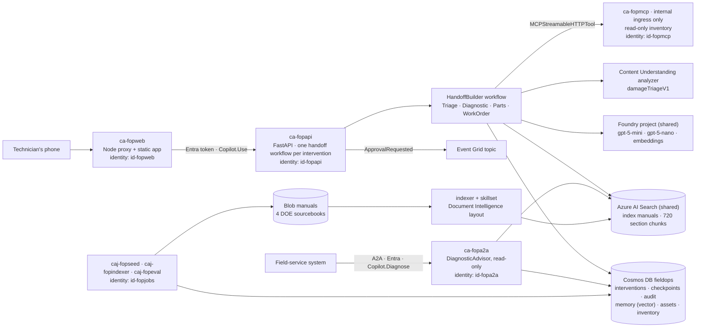
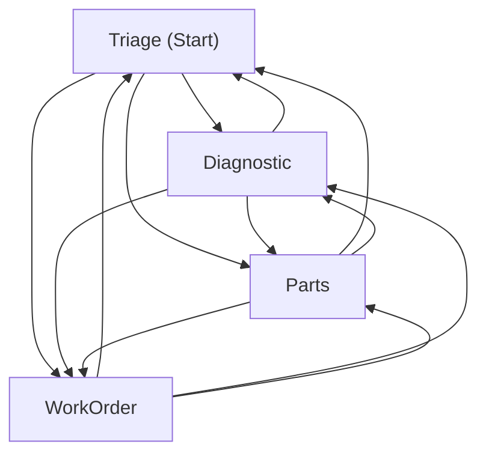
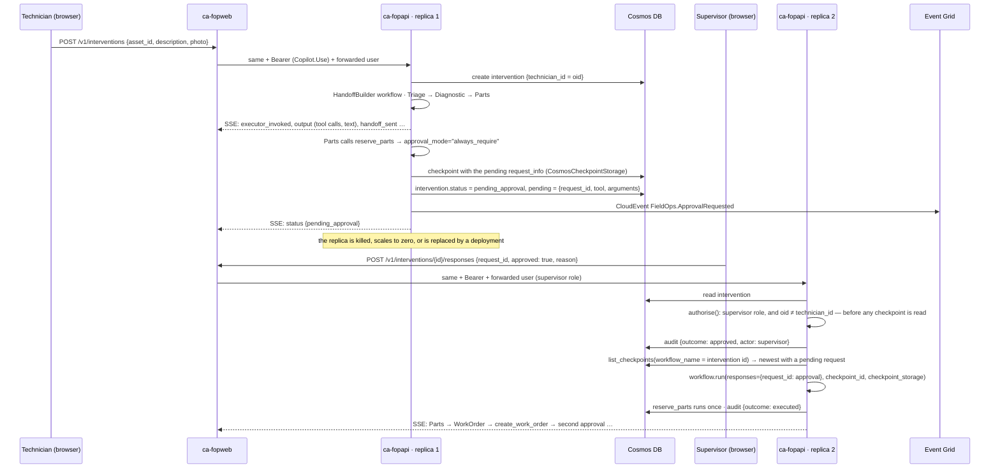

# Architecture

Four specialist agents on Microsoft Agent Framework prepare a maintenance intervention from a
technician's fault report or photograph: the manual, the asset's history, similar resolved cases,
the parts in stock and a drafted work order. The architecture is a **control plane for agents with
tools**: every write is a local tool behind a human approval that survives a process restart, the
approver is never the requester, and every tool call and handoff is written to an append-only
audit container before the result is used.

## Containers

| Component | Runs | Identity | What it may touch |
|---|---|---|---|
| `ca-fopweb` | `web/server.ts` serving `web/dist` and proxying `/v1/*` with a token for `api://<client id>` | `id-fopweb` | the API only |
| `ca-fopapi` | `app/main.py` on uvicorn, external ingress, Entra authentication required at the ingress and the `Copilot.Use` app role in the code, multiple revisions for the canary | `id-fopapi` | the Foundry project and account, the search index (reader), the `fieldops` database (data contributor), the Event Grid topic (sender), Application Insights |
| `ca-fopmcp` | `python -m mcp_inventory.server`, **internal ingress only** | `id-fopmcp` | the `inventory` container (reader) |
| `ca-fopa2a` | `uvicorn a2a_server.main:app`, external ingress, Entra required, `Copilot.Diagnose` checked in the code | `id-fopa2a` | the project and account, the search index (reader), `assets` and `memory` (reader) |
| `caj-fopseed`, `caj-fopindexer`, `caj-fopeval` | `ops.seed`, `ops.index`, `eval.run --suite full` (Mondays 06:00 UTC) | `id-fopjobs` | the `manuals` container (blob contributor), the search service (contributor), Cosmos (data contributor), the project |
| shared search service | indexer, skillset, index projection | its own system identity | the `manuals` container (blob reader), the embedding deployment through the Foundry account |

Everything shared — the Foundry account and project, the model deployments, the search service,
the container registry, Log Analytics, the action group — is created by `azure-ai-landing-zone` and
referenced through the `landingZone` parameter. This repository creates its own resource group's
resources only: five identities, storage, Cosmos, Event Grid, Application Insights, the Container
Apps environment, four apps, three jobs, two alerts, a budget, and every role assignment,
including the ones on shared resources (`infra/modules/shared-access.bicep`).

## The handoff graph, as the framework sees it

Generated with `WorkflowViz(workflow).to_mermaid()` from the workflow `app/workflow.py` builds
(`tests` build the same workflow with a scripted model):

The framework wires every participant to every other at the executor level and routes through its
handoff coordinator; **which handoffs an agent can actually take is decided by the handoff tools it
is given**, and that is where this repository restricts the graph (`HandoffBuilder.add_handoff` in
`app/workflow.py`, asserted by `tests/test_eval.py` through the tool definitions the evaluation
reads from the built workflow):

| Agent | Model | Handoff tools | Own tools | Context providers |
|---|---|---|---|---|
| Triage (start) | gpt-5-mini | `handoff_to_Diagnostic`, `handoff_to_Parts` | `asset_history` | Content Understanding (`damageTriageV1`) |
| Diagnostic | gpt-5-mini | `handoff_to_Parts`, `handoff_to_WorkOrder` | `search_manual` | similar resolved cases (Cosmos vector search) |
| Parts | gpt-5-nano | `handoff_to_WorkOrder`, `handoff_to_Diagnostic` | `find_parts`, `part_stock` (MCP, read-only), `reserve_parts` (approval) | — |
| WorkOrder | gpt-5-mini | none; the run ends when its message carries the work-order number | `create_work_order` (approval) | — |

Every agent carries the same two middlewares: `AuditMiddleware` (one `create_item` per tool call
and handoff) and `PolicyMiddleware` (catalogue and quantity bound before `reserve_parts` runs).

## An approval across a process restart

`tests/test_workflow.py` is this diagram as a test: it stops after the approval request, builds
a second runtime from the checkpoint, answers, and asserts that the privileged tool ran exactly
once and that nothing ran when the answer was a denial.

## The authorisation boundary

There is no virtual network. What a caller must present is an Entra token for the API's app
registration carrying the `Copilot.Use` app role (`infra/modules/apps.bicep`, `authConfigs`;
`app/main.py`, `verify_token`). The web proxy requests that token with its managed identity and
forwards the signed-in user's object id and roles (`web/server.ts`); the API honours those headers
only when the token belongs to the proxy's own identity (`PROXY_PRINCIPAL_ID`), so a direct caller
cannot impersonate anyone. Every route authorises the caller against the intervention **before** a
checkpoint is loaded; the continuation identifier is never trusted on its own. The MCP server has
no public address; the A2A server exposes a read-only agent with its own role (ADR-006, ADR-011).

## Environments

`azd up` provisions `rg-fopcopilot-prod-swc` from `infra/` and deploys the four containers; the
Bicep is `targetScope = 'resourceGroup'` and never creates the group. Locally, `make run`,
`make mcp` and `make a2a` start the three Python servers against Azure with the developer's own
login (`DefaultAzureCredential`) and `REQUIRE_AUTH=false`, in which case the `x-demo-user` header
names the acting technician or supervisor; `make web` serves the frontend through the same proxy
the container runs. `VITE_DEMO_MODE=true` builds the static demo published on GitHub Pages, which
replays the recorded interventions in `web/fixtures/` with their real timings and never calls a
backend.
